# Fastoria — Supabase CMS Schema (ERD)

> **Scope**: CMS-only — semua data landing page (kompetisi, timeline, kontak, FAQ, sponsor, hero, marquee) dikelola lewat Supabase agar bisa diubah tanpa deploy ulang. Termasuk auth system untuk admin CMS.

---

## Entity Relationship Diagram

```mermaid
erDiagram
    %% ─── AUTH SYSTEM ───────────────────────────────────────────

    admin_profiles {
        uuid id PK "= auth.users.id (1:1 mapping)"
        text display_name "Nama tampilan di CMS"
        text role "super_admin | admin"
        timestamptz last_login_at "terisi otomatis saat login"
        timestamptz created_at
        timestamptz updated_at
    }

    %% ─── CMS CONTENT TABLES ────────────────────────────────────

    site_settings {
        uuid id PK "ID unik otomatis (UUID v4)"
        text key UK "nama setting, misal: event_name, social_links"
        jsonb value "isi setting, bisa string/number/object/array"
        text description "catatan internal untuk admin"
        uuid updated_by FK "admin yang terakhir mengedit"
        timestamptz created_at "otomatis terisi saat data dibuat"
        timestamptz updated_at "otomatis terupdate saat data diubah"
    }

    competition_categories {
        uuid id PK
        text slug UK "misal: design, tech"
        text label "misal: Design & Creative"
        integer sort_order
        uuid updated_by FK
        timestamptz created_at
        timestamptz updated_at
    }

    competition_categories ||--o{ competitions : "has"

    competitions {
        uuid id PK
        uuid category_id FK "referensi ke competition_categories"
        text title
        text description
        text image_path "Supabase Storage path"
        text image_alt
        text[] tags "array: Tim 2-3 Orang, etc."
        integer fee_amount "nominal: 120000"
        text fee_unit "/ Tim | / Orang"
        text slot_badge_label "EARLY BIRD SLOT"
        text guidebook_url "link or storage path"
        integer sort_order "display ordering"
        uuid updated_by FK
        timestamptz created_at
        timestamptz updated_at
    }

    timeline_steps {
        uuid id PK
        integer step_number "1, 2, 3, etc."
        text title
        text description
        timestamptz start_date "event date or range start"
        timestamptz end_date "range end (null for single-day)"
        uuid updated_by FK
        timestamptz created_at
        timestamptz updated_at
    }

    contacts {
        uuid id PK
        text category_tag "TEKNIS & PANDUAN"
        text name "Sarah Adelia"
        text description
        text contact_value "+62 812-xxx"
        text action_label "Chat WhatsApp"
        text action_href "https://wa.me/xxx"
        text action_variant "whatsapp | email"
        integer sort_order
        uuid updated_by FK
        timestamptz created_at
        timestamptz updated_at
    }

    faqs {
        uuid id PK
        text question
        text answer
        integer sort_order
        uuid updated_by FK
        timestamptz created_at
        timestamptz updated_at
    }

    sponsors {
        uuid id PK
        text name
        text url "website link"
        text logo_path "Supabase Storage path (SVG / PNG / WebP)"
        integer sort_order
        uuid updated_by FK
        timestamptz created_at
        timestamptz updated_at
    }

    marquee_items {
        uuid id PK
        text content "✦ UI/UX DESIGN CHALLENGE"
        integer sort_order
        uuid updated_by FK
        timestamptz created_at
        timestamptz updated_at
    }

    hero_content {
        uuid id PK
        text headline "Tunjukkan Bakat, Rebut Total Hadiah"
        text prize_label "Rp 75.000.000!"
        text subheadline "Ajang kompetisi nasional..."
        text cta_primary_label "Daftar Sekarang"
        text cta_primary_href "#kategori"
        text cta_secondary_label "Unduh Rulebook (PDF)"
        text cta_secondary_href "#panduan"
        text badge_top_left "PENDAFTARAN GELOMBANG 2 DIBUKA"
        text badge_top_right "KUOTA TERBATAS"
        uuid updated_by FK
        timestamptz created_at
        timestamptz updated_at
    }

    %% ─── AUTH RELATIONSHIPS ────────────────────────────────────

    admin_profiles ||--o{ site_settings : "updated_by"
    admin_profiles ||--o{ competition_categories : "updated_by"
    admin_profiles ||--o{ competitions : "updated_by"
    admin_profiles ||--o{ timeline_steps : "updated_by"
    admin_profiles ||--o{ contacts : "updated_by"
    admin_profiles ||--o{ faqs : "updated_by"
    admin_profiles ||--o{ sponsors : "updated_by"
    admin_profiles ||--o{ marquee_items : "updated_by"
    admin_profiles ||--o{ hero_content : "updated_by"
```



---

## Data Mapping — Hardcoded Constants → Supabase Tables

| Frontend Source File | Table | Notes |
|---|---|---|
| [`CompetitionSection.constants.ts`](file:///d:/fastoria/src/components/organisms/CompetitionSection/CompetitionSection.constants.ts) | `competition_categories` & `competitions` | 4 categories + 4 competition items |
| [`TimelineSection.constants.ts`](file:///d:/fastoria/src/components/organisms/TimelineSection/TimelineSection.constants.ts) | `timeline_steps` | 5 milestones → rows |
| [`ContactSection.constants.ts`](file:///d:/fastoria/src/components/organisms/ContactSection/ContactSection.constants.ts) | `contacts` + `faqs` | 3 contacts + 3 FAQ items |
| [`SponsorSection.constants.tsx`](file:///d:/fastoria/src/components/organisms/SponsorSection/SponsorSection.constants.tsx) | `sponsors` | 8 sponsor logos → rows |
| [`MarqueeTicker.tsx`](file:///d:/fastoria/src/components/organisms/MarqueeTicker/MarqueeTicker.tsx) (inline) | `marquee_items` | 8 ticker items → rows |
| [`Hero.tsx`](file:///d:/fastoria/src/components/organisms/Hero/Hero.tsx) (inline JSX) | `hero_content` | Headlines, CTAs, badges |
| [`CountdownTimer.tsx`](file:///d:/fastoria/src/components/molecules/CountdownTimer/CountdownTimer.tsx) & Footer / Global | `site_settings` | Global config: target tanggal hitung mundur (`countdown_target`), nama event, tanggal event, social media links |
| *(Admin Panel — belum ada)* | `admin_profiles` | Profil admin CMS, terhubung 1:1 ke `auth.users` |

---

## Design Decisions

### 1. Flat Tables (No Over-Normalization)
Setiap tabel langsung merepresentasikan satu section UI. Tidak perlu join tables karena scope CMS ini sederhana — admin edit data, frontend fetch & render.

### 2. Direct Content Management (No `is_published` Flag)
Konten dikelola secara langsung (*create/edit/delete*) tanpa toggle `is_published` untuk menyederhanakan alur kerja admin CMS. Kolom `sort_order` (integer) digunakan untuk mengontrol urutan tampilan.

### 3. Image Storage Strategy
- **`competitions.image_path`** dan **`sponsors.logo_path`** menyimpan path file di Supabase Storage bucket (`competition-images/` dan `sponsor-logos/`)
- Semua logo sponsor (baik file format SVG, PNG, maupun WebP) disimpan seragam sebagai file di Storage dan dirender menggunakan tag `` di frontend

### 4. `site_settings` (Key-Value)
Untuk data global yang tidak cocok di tabel spesifik: target hitung mundur pendaftaran/acara (`countdown_target`), nama event, tanggal event, social media links, dll. Format JSONB untuk fleksibilitas.

### 5. `hero_content` — Singleton Row
Tabel ini dirancang hanya memiliki 1 baris konten yang diedit langsung oleh admin (*direct edit*). Frontend cukup mengambil row tunggal dengan `.limit(1).single()`.

### 6. Fee Amount as Integer
`fee_amount` disimpan sebagai integer (dalam Rupiah) bukan string, agar bisa diproses secara programmatic. Formatting "Rp 120.000" dilakukan di frontend.

### 7. Step Number as Integer & Single Source of Order
`step_number` pada `timeline_steps` disimpan sebagai integer (1, 2, 3...) untuk konsistensi data numerik sekaligus penentu urutan alur timeline (mengeliminasi perlunya kolom `sort_order`). Penomoran dua digit ("01", "02") diformat di frontend menggunakan `.toString().padStart(2, '0')`.

### 8. Simplified Timeline Dates (`start_date` & `end_date`)
Tanggal milestone disederhanakan menjadi 2 kolom:
- `start_date` (NOT NULL): tanggal acara atau awal rentang.
- `end_date` (NULL): tanggal akhir rentang. Jika `NULL`, berarti acara 1 hari (*single-day event*).

### 9. Auth & Access Control — Two-Tier Roles (`super_admin` & `admin`)
Menggunakan `auth.users` bawaan Supabase sebagai identity provider (email/password login). Tabel `admin_profiles` adalah extension 1:1 yang menyimpan metadata CMS-specific:
- **`id`** = `auth.users.id` (shared UUID, 1:1 mapping)
- **`role`** = `'super_admin'` | `'admin'`
  - **`super_admin`**: Memiliki hak penuh untuk mengelola admin lain (CRUD pada `admin_profiles`), melihat seluruh daftar admin, serta mengelola semua konten CMS.
  - **`admin`**: Hanya fokus mengelola konten landing page (CRUD pada 9 tabel konten). Tidak bisa melihat daftar admin lain dan tidak bisa mengedit profil admin lain (hanya bisa read & update profil miliknya sendiri).
- **Tanpa kolom `is_active`**: Manajemen akses sepenuhnya dikendalikan oleh `super_admin`. Super admin dapat langsung menghapus akun admin atau mengedit perannya bila diperlukan.
- **`updated_by`** pada setiap tabel konten tetap melacak admin/super admin mana yang terakhir mengubah data (*lightweight audit trail*).

---

## Supabase-Specific Features

### Row Level Security (RLS)
```
CMS Content Tables (semua tabel konten):
- SELECT: anon / public (landing page bisa dibaca siapa saja)
- INSERT/UPDATE/DELETE: authenticated (super_admin & admin)
  → Policy: auth.uid() IN (SELECT id FROM admin_profiles WHERE role IN ('super_admin', 'admin'))

admin_profiles:
- SELECT:
  - super_admin: melihat semua profil admin
  - admin: hanya bisa melihat profil dirinya sendiri
  → Policy: (SELECT role FROM admin_profiles WHERE id = auth.uid()) = 'super_admin' OR auth.uid() = id
- INSERT: super_admin only (atau via Supabase Admin API / trigger saat pembuatan user)
  → Policy: (SELECT role FROM admin_profiles WHERE id = auth.uid()) = 'super_admin'
- UPDATE:
  - super_admin: bisa update semua profil
  - admin: hanya bisa update profil miliknya sendiri (display_name)
  → Policy: (SELECT role FROM admin_profiles WHERE id = auth.uid()) = 'super_admin' OR auth.uid() = id
- DELETE: super_admin only (dibatasi agar tidak bisa menghapus diri sendiri untuk mencegah lockout)
  → Policy: (SELECT role FROM admin_profiles WHERE id = auth.uid()) = 'super_admin' AND id != auth.uid()
```

### Storage Buckets
```
- competition-images/   → gambar kompetisi
- sponsor-logos/         → logo sponsor (PNG/SVG)
- documents/             → guidebook PDF, rulebook
```

### Realtime (Optional)
Enable Realtime pada tabel yang sering berubah (`competitions`, `hero_content`) agar perubahan admin langsung terlihat tanpa refresh.