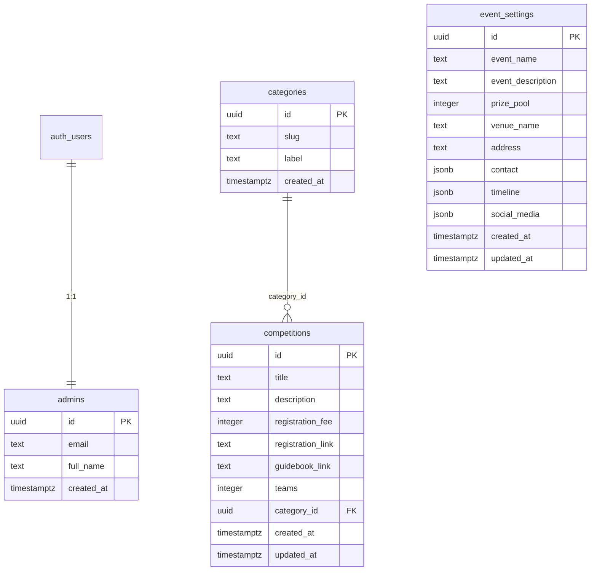

# ERD — Fastoria CMS

Desain database untuk CMS dashboard yang mengelola konten LandingPage.
Dokumen ini **mencerminkan schema aktual** di project Supabase
`xhptzjvzqvosfmaklqgx` (dibuat manual via dashboard, belum ada migration).

Filosofi: **sesimpel mungkin**. Hanya konten tertentu yang dikelola lewat
dashboard; semua yang berkaitan dengan tampilan (badge, warna, ikon, label
tombol, layout) ditangani di frontend.

- **Backend:** Supabase (Postgres + Auth)
- **Total tabel:** 4 (`admins`, `categories`, `competitions`, `event_settings`)
- **Login admin:** Supabase Auth (`auth.users`) — tidak ada tabel password sendiri
- Semua timestamp memakai `timestamptz` (UTC)
- Semua identifier `snake_case`; uang disimpan sebagai `integer` (rupiah)

---

## 1. Diagram



Relasi:
- `admins.id` → `auth.users.id` (1:1, `on delete cascade`)
- `competitions.category_id` → `categories.id` (banyak lomba per kategori; nullable)

---

## 2. Tabel

### 2.1 `admins` — admin CMS

Ekstensi 1:1 dari `auth.users`. Autentikasi (login, password, sesi) ditangani
Supabase Auth. Keberadaan baris di tabel ini = user tsb adalah admin.

| Kolom | Tipe | Null | Default | Keterangan |
|---|---|---|---|---|
| `id` | `uuid` | tidak | `gen_random_uuid()` | PK, FK → `auth.users(id)` `on delete cascade` |
| `email` | `text` | tidak | — | **unique** |
| `full_name` | `text` | tidak | — | nama admin |
| `created_at` | `timestamptz` | tidak | `now()` | |

> Catatan: tidak ada kolom `role` — semua baris `admins` dianggap admin.

### 2.2 `categories` — kategori lomba

Dipakai frontend untuk membangun tab filter.

| Kolom | Tipe | Null | Default | Keterangan |
|---|---|---|---|---|
| `id` | `uuid` | tidak | `gen_random_uuid()` | PK |
| `slug` | `text` | tidak | — | **unique**; mis. `design`, `tech`, `business` |
| `label` | `text` | tidak | — | nama tampil, mis. `Design & Creative` |
| `created_at` | `timestamptz` | tidak | `now()` | |

> Tidak ada kolom `sort_order` / `is_active`. Urutan tab ditentukan frontend
> (atau tambahkan `sort_order` bila ingin diatur dari dashboard).

### 2.3 `competitions` — koleksi lomba

| Kolom | Tipe | Null | Default | Keterangan |
|---|---|---|---|---|
| `id` | `uuid` | tidak | `gen_random_uuid()` | PK |
| `title` | `text` | tidak | — | nama lomba |
| `description` | `text` | tidak | — | deskripsi lomba |
| `registration_fee` | `integer` | tidak | — | biaya pendaftaran (rupiah) |
| `registration_link` | `text` | tidak | — | link pendaftaran |
| `guidebook_link` | `text` | tidak | — | link guidebook/rulebook |
| `teams` | `integer` | ya | — | jumlah anggota tim; `2` = lomba 2 orang; `null`/`1` = individu |
| `category_id` | `uuid` | ya | — | FK → `categories(id)`; `null` = tanpa kategori |
| `created_at` | `timestamptz` | tidak | `now()` | |
| `updated_at` | `timestamptz` | tidak | `now()` | |

> Tidak ada `is_published` dan `sort_order`. Semua baris lomba langsung publik;
> urutan tampil saat ini dari frontend.

### 2.4 `event_settings` — pengaturan global event

| Kolom | Tipe | Null | Default | Keterangan |
|---|---|---|---|---|
| `id` | `uuid` | tidak | `gen_random_uuid()` | PK |
| `event_name` | `text` | tidak | — | nama event |
| `event_description` | `text` | tidak | — | deskripsi singkat event |
| `prize_pool` | `integer` | tidak | — | total hadiah (rupiah) |
| `venue_name` | `text` | tidak | — | nama venue/sekretariat |
| `address` | `text` | tidak | — | alamat |
| `contact` | `jsonb[]` | tidak | `'{}'` | array objek kontak (lihat 3.1) |
| `timeline` | `jsonb[]` | tidak | `'{}'` | array objek milestone (lihat 3.2) |
| `social_media` | `jsonb[]` | tidak | `'{}'` | array objek sosial media (lihat 3.3) |
| `created_at` | `timestamptz` | tidak | `now()` | |
| `updated_at` | `timestamptz` | tidak | `now()` | |

> **Bukan singleton yang dipaksa.** `id` berupa `uuid` bebas, jadi secara
> schema bisa ada >1 baris. Konvensi: aplikasi memperlakukan tabel ini sebagai
> satu baris (mis. ambil baris pertama). Bila ingin dipaksa 1 baris, bisa
> ditambah constraint (mis. `check`/unique pada kolom konstan).
>
> Perhatikan tipe `contact`/`timeline`/`social_media` adalah **`jsonb[]`**
> (array Postgres berisi `jsonb`), bukan `jsonb` tunggal.

---

## 3. Bentuk elemen array `jsonb`

Setiap elemen array adalah satu objek `jsonb`. Frontend menerimanya sebagai
`array of objects`.

### 3.1 `contact`
```json
[
  { "type": "whatsapp", "label": "CP Teknis", "value": "+62 812-3456-7890" },
  { "type": "email", "label": "Email Sekretariat", "value": "halo@arenafest.id" }
]
```

### 3.2 `timeline`
```json
[
  {
    "step": 1,
    "title": "Pendaftaran & Pembayaran",
    "description": "Buka pendaftaran gelombang 2.",
    "start_date": "2026-09-01",
    "end_date": "2026-09-30"
  },
  {
    "step": 2,
    "title": "Technical Meeting",
    "description": "Sesi briefing teknis untuk peserta.",
    "start_date": "2026-10-05",
    "end_date": null
  }
]
```

> Deadline pendaftaran untuk countdown **tidak disimpan** sebagai kolom
> terpisah — diturunkan dari `timeline` dan diolah di frontend.

### 3.3 `social_media`
```json
[
  { "platform": "instagram", "label": "IG @arenafest.id", "url": "https://instagram.com/arenafest.id" },
  { "platform": "twitter", "label": "X @arenafest", "url": "https://x.com/arenafest" }
]
```

---

## 4. RLS (Row Level Security) — kondisi aktual

RLS **aktif** di keempat tabel. Policy yang terpasang:

| Tabel | Policy | Role | Command | Kondisi |
|---|---|---|---|---|
| `admins` | Enable users to view their own data only | `authenticated` | SELECT | `auth.uid() = id` |
| `categories` | Enable read access for all users | `public` | SELECT | `true` |
| `categories` | Enable all for authenticated users | `authenticated` | ALL | `true` |
| `competitions` | Enable read access for all users | `public` | SELECT | `true` |
| `competitions` | Enable all for authenticated users | `authenticated` | ALL | `true` |
| `event_settings` | Enable read access for all users | `public` | SELECT | `true` |
| `event_settings` | Enable all for authenticated users | `authenticated` | ALL | `true` |

Arti praktis:
- **Baca** (`categories`, `competitions`, `event_settings`) terbuka untuk `anon`
  → landing page bisa baca dengan anon key.
- **Tulis** hanya untuk user `authenticated` (login).
- `admins` hanya bisa dibaca oleh user itu sendiri.

> **Yang perlu diperhatikan:** policy "Enable all for authenticated users"
> memakai `using (true)`, artinya **siapa pun yang punya akun Auth** bisa
> menulis — tidak dibatasi ke anggota tabel `admins`. Aman selama signup
> publik dimatikan dan hanya akun admin yang ada. Bila ingin lebih ketat,
> ganti `using`/`with check` menjadi:
> ```sql
> exists (select 1 from public.admins a where a.id = auth.uid())
> ```

### Advisor (per saat ini)

- **Security:** bersih (tidak ada temuan).
- **Performance:** 2 catatan (keduanya non-blocking):
  1. `unindexed_foreign_keys` — `competitions.category_id` belum punya index.
  2. `multiple_permissive_policies` — pada `categories`, `competitions`,
     `event_settings` ada dua policy permissive untuk role `authenticated`
     action `SELECT` (policy `ALL` + policy `SELECT public`).

---

## 5. SQL referensi (DDL aktual)

> Ini merekonstruksi kondisi yang sudah ada di database. Tidak perlu dijalankan
> ulang — hanya sebagai dokumentasi.

```sql
-- ===== 1. admins =====
create table public.admins (
  id          uuid primary key default gen_random_uuid() references auth.users(id) on delete cascade,
  email       text not null unique,
  full_name   text not null,
  created_at  timestamptz not null default now()
);

alter table public.admins enable row level security;

create policy "Enable users to view their own data only"
on public.admins for select
to authenticated
using (auth.uid() = id);

-- ===== 2. categories =====
create table public.categories (
  id          uuid primary key default gen_random_uuid(),
  slug        text not null unique,
  label       text not null,
  created_at  timestamptz not null default now()
);

alter table public.categories enable row level security;

create policy "Enable read access for all users"
on public.categories for select to public using (true);

create policy "Enable all for authenticated users"
on public.categories for all to authenticated using (true);

-- ===== 3. competitions =====
create table public.competitions (
  id                 uuid primary key default gen_random_uuid(),
  title              text not null,
  description        text not null,
  registration_fee   integer not null,
  registration_link  text not null,
  guidebook_link     text not null,
  teams              integer,
  category_id        uuid references public.categories(id),
  created_at         timestamptz not null default now(),
  updated_at         timestamptz not null default now()
);

alter table public.competitions enable row level security;

create policy "Enable read access for all users"
on public.competitions for select to public using (true);

create policy "Enable all for authenticated users"
on public.competitions for all to authenticated using (true);

-- ===== 4. event_settings =====
create table public.event_settings (
  id                 uuid primary key default gen_random_uuid(),
  event_name         text not null,
  event_description  text not null,
  prize_pool         integer not null,
  venue_name         text not null,
  address            text not null,
  contact            jsonb[] not null default '{}'::jsonb[],
  timeline           jsonb[] not null default '{}'::jsonb[],
  social_media       jsonb[] not null default '{}'::jsonb[],
  created_at         timestamptz not null default now(),
  updated_at         timestamptz not null default now()
);

alter table public.event_settings enable row level security;

create policy "Enable read access for all users"
on public.event_settings for select to public using (true);

create policy "Enable all for authenticated users"
on public.event_settings for all to authenticated using (true);
```

### Opsional (perbaikan yang disarankan advisor)

```sql
-- index untuk FK yang belum ter-index
create index competitions_category_id_idx
  on public.competitions (category_id);

-- auto-update updated_at
create or replace function public.set_updated_at()
returns trigger language plpgsql as $$
begin
  new.updated_at = now();
  return new;
end $$;

create trigger competitions_set_updated_at
  before update on public.competitions
  for each row execute function public.set_updated_at();

create trigger event_settings_set_updated_at
  before update on public.event_settings
  for each row execute function public.set_updated_at();
```

---

## 6. Mapping konten LandingPage → tabel

| Konten landing | Sumber sekarang | Tujuan CMS |
|---|---|---|
| Judul & deskripsi hero | hardcoded `Hero.tsx` | **tetap di frontend** |
| `prize_pool`, `venue`, `address`, kontak, sosial media, timeline | `Footer/Contact/Timeline` constants | `event_settings` |
| Daftar lomba (title, description, fee, link daftar, guidebook) | `CompetitionSection.constants.ts` | `competitions` |
| Kategori lomba (untuk filter) | `CompetitionItem.category` | `categories` (+ `competitions.category_id`) |
| Jumlah anggota tim | `CompetitionItem.tags` | `competitions.teams` |
| Admin CMS | — | `admins` (+ Supabase Auth) |
| Label & urutan tab kategori, badge, `fee_unit`, tags, ikon, warna, label tombol | constants/JSX | **tetap di frontend** |
| FAQ, sponsor, nav links, ticker | constants/JSX | **tetap di frontend** (di luar scope CMS) |

### Field yang sengaja TIDAK disimpan
Field UI/Tailwind-only seperti `BadgeColor`, `CardBgColor`, `ButtonVariant`,
`hoverColorClass`, `slot_badge_label`, `imageAlt`, label/urutan tab kategori,
dan seluruh teks statis section — ditangani di frontend.
